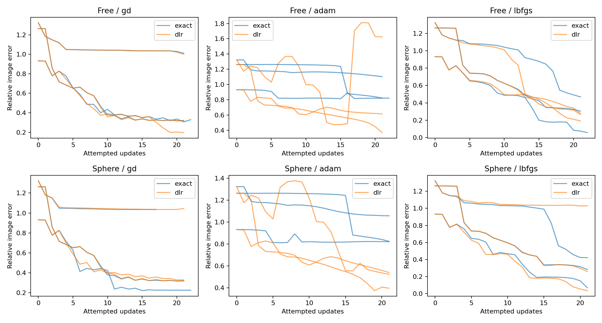
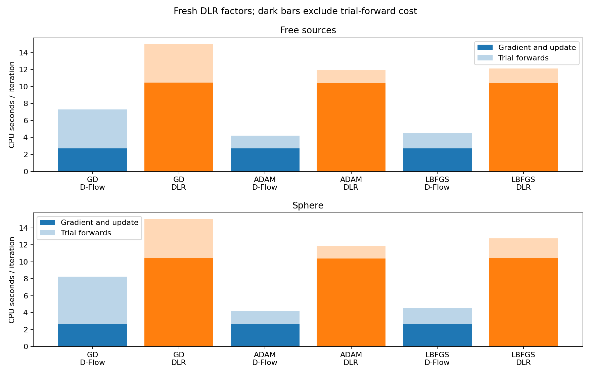
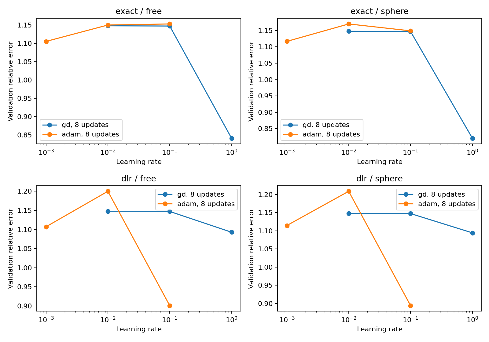
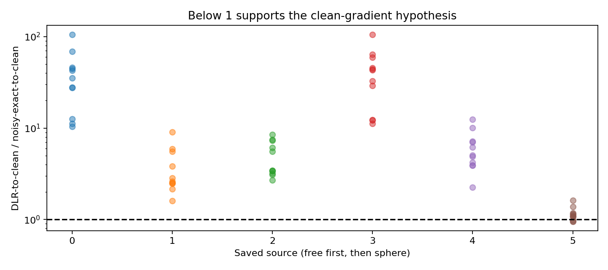
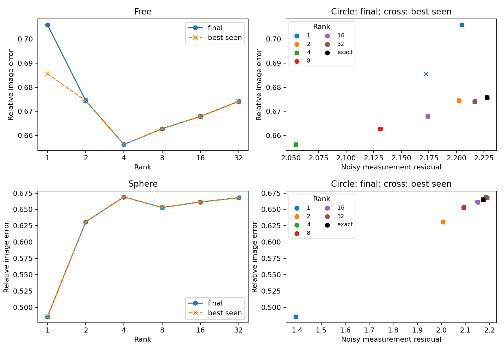

# First-order D-Flow/DLR study — 2026-09-30

The DLR accuracy advantage survives GD in the unconstrained comparison, but reverses under spherical projection. LBFGS remains competitive and achieves lower matched image errors than GD or Adam in most comparisons here. The clean-gradient hypothesis receives only limited, local support: DLR is closer to the clean gradient in 3 of 66 conditional noise checks, all at one late source.

This is a three-image pilot with one validation image, not a population-level ranking or a recommendation to change production optimizer defaults.

## Protocol and completion

The study uses the non-attention circles-64 epoch-100 checkpoint, **100 Euler steps**, 15-angle sparse CT, and Gaussian measurement noise normalized to **1% relative L2**. The objective is half the squared measurement-residual norm, with no clipping or additional regularizer. Sources are either unconstrained or projected to radius 64.

Every DLR gradient recomputes rank-8 factors with **analytical alpha = 1 − t, zero trace probes, zero enrichment, initialization oversampling 8, and exactly zero terminal alpha**. Initialization sketches remain randomized and paired by seed. All optimizers use lifetime-first-attempt L1 step scaling and a 0.64 displacement cap. Armijo evaluates actual projected candidates where applicable.

Completed in **219.9 minutes (3 hours 40 minutes)**:

- All 24 validation configurations × 8 updates: 192 updates.
- 756 held-out update attempts across 36 configurations. Most reached 21 updates; four reached 22 before the phase deadline. One exact spherical-GD trajectory stalled at 17. The 30-update target was not reached.
- All six ranks plus an exact control, both constraints, 10 updates each: 140 updates.
- All six initial/midpoint/final diagnostic sources, each with the trajectory noise and ten additional noise realizations.
- Six independently refined spectral references with CPU residual verification: three fully numerically certified and three with unresolved rank-8 cutoffs.

Reconstruction and optimizer timings use two CPU threads. After GPU 0 became available, supplemental spectral refinement used GPU 0 with TF32 disabled, up to four concurrent CPU compute threads overall, and about 1.6 GiB peak allocated VRAM. The CPU reconstruction data and timings were unchanged.

## Optimizers and accuracy

Numbers below are **mean raw relative image errors**, averaged over the same three test images at common attempted-update counts. Lower is better. Stalled trajectories remain included.

| Constraint | Optimizer | Matched updates | D-Flow | DLR |
| --- | --- | --- | --- | --- |
| Free | GD + Armijo | 21 | 54.53% | **50.59%** |
| Sphere | GD + Armijo | 17 | **52.92%** | 57.58% |
| Free | Adam | 21 | 91.68% | **87.03%** |
| Sphere | Adam | 21 | 90.16% | **48.76%** |
| Free | LBFGS + Armijo | 21 | 28.21% | **24.45%** |
| Sphere | LBFGS + Armijo | 21 | **25.76%** | 44.17% |

Validation selected GD lr=1 for both estimators and constraints. Adam selected lr=0.001 for exact D-Flow and lr=0.1 for DLR, under both constraints. LBFGS used lr=1 and history 100 as the planned control. These rates were selected after only eight validation updates; they are not established long-horizon optima. Several selections lie at grid boundaries.

The GD result shows that an advantage can occur without LBFGS, but it is conditional on the source constraint and iteration count. It does not establish that LBFGS causes the earlier advantage, or that first-order methods should replace it. Individual images differ substantially; some trajectories remain in poor reconstruction states while others achieve much lower error.

Fresh-factor DLR costs approximately **10.4 s per gradient/update versus 2.7 s for exact D-Flow**, excluding trial forwards, on this CPU setup. That is approximately 3.9× slower. Total iteration cost also depends on line search; the detailed report includes both. These fresh-factor measurements do not use the factor reuse present in earlier speed profiles.

## Four-gradient comparison

At the same source and native Euler endpoint, the study compares the exact gradient, the independently estimated rank-8 truncated gradient, the DLR gradient, and the exact gradient projected onto DLR's right subspace. The reference differentiates the actual 100-step Euler map.

All errors in this table are normalized by the exact gradient norm:

| Constraint | Update | DLR error | DLR-subspace projection error | Rank-8 reference error | Reference status |
| --- | --- | --- | --- | --- | --- |
| Free | 0 | 5.93% | 4.33% | 0.313% | Certified numerically |
| Free | 11 | 4.50% | 3.13% | 0.235% | Certified numerically |
| Free | 22 | 3.70% | 3.13% | 0.070% | Ambiguous cutoff |
| Sphere | 0 | 5.86% | 4.31% | 0.240% | Certified numerically |
| Sphere | 11 | 3.01% | 2.30% | 0.041% | Ambiguous cutoff |
| Sphere | 22 | 4.05% | 3.51% | 0.464% | Ambiguous cutoff |

DLR cosines with the exact noisy gradient are 0.9987–0.9997. Despite this close directional alignment, its error is substantially larger than the certified rank-8 reference errors. Both its evolving subspace and its coefficients contribute: the orthogonal error decomposition holds to a maximum relative discrepancy of 3.0e-5 in float32. Thus the implemented DLR approximation is not equivalent to optimally truncating the true Jacobian.

For example, the initial unconstrained reference has leading singular values approximately 39.49, 9.75, 7.43, and 0.12. This supports strong concentration in a few singular directions at that source. It does not, by itself, establish a stable invariant manifold.

Certified references pass the 1e-3 relative singular-triplet residual threshold, the 1% gradient-refinement stability threshold, and a resolved cutoff check. Supplemental GPU references are independently checked using CPU Jacobian products. CPU/GPU endpoint differences are at most 2.4e-6, and gradient differences at most 1.25e-5, in relative norm. The three ambiguous cutoffs remain explicitly unresolved; their reported truncations should not be treated as uniquely identified exact rank-8 references.

Selected true Strong Wolfe checks passed at 12 of 36 tested trial rates. Initial-point and final spherical-point trials did not meet both conditions. This was a directional-derivative diagnostic, not a tuned Strong Wolfe optimizer comparison.

## Clean-gradient hypothesis

The ratio is

`R = ||DLR noisy gradient − exact clean gradient|| / ||exact noisy gradient − exact clean gradient||`.

Values below one support the proposed inequality at that fixed source and noise realization.

| Constraint | Update | R for trajectory noise | R < 1 among 11 noise realizations |
| --- | --- | --- | --- |
| Free | 0 | 68.667 | 0 |
| Free | 11 | 5.581 | 0 |
| Free | 22 | 2.703 | 0 |
| Sphere | 0 | 63.951 | 0 |
| Sphere | 11 | 7.024 | 0 |
| Sphere | 22 | 0.957 | 3 |

Across all 66 checks, the median ratio is **5.75**, with range **0.957–105.42**. The three successes occur at the same final spherical source and improve clean-gradient distance by at most about **4.3%**. Every DLR approximation differs nontrivially from the exact noisy gradient.

This does not support a general claim that DLR produces a cleaner gradient. It leaves room for a small, local effect late in some trajectories. These noise realizations are conditional tests at six saved sources on one image, not 66 independent reconstruction experiments. Accuracy improvements therefore cannot generally be attributed to the proposed clean-gradient inequality on the evidence here.

## Rank sweep and limitations

The rank sweep uses test image 0, ten updates, and Adam lr=0.1 selected from DLR validation. The same settings are applied to every rank and the exact-gradient control; this control is distinct from the separately tuned exact-Adam comparison above.

| Constraint | Best final DLR rank | Its image error | Rank 32 error | Exact-control error |
| --- | --- | --- | --- | --- |
| Free | 4 | 65.63% | 67.41% | 67.58% |
| Sphere | 1 | 48.57% | 66.79% | 66.52% |

Measurement residuals are **not monotonic in rank**. Rank 32 ends near the exact control under these fixed settings, but all rank-sweep residuals remain approximately **29–47 times the noise norm**. This is evidence about short optimization trajectories, not converged bias–variance behavior or noise-floor regularization. Increasing rank changes the approximate search direction; these are not nested least-squares solves that guarantee monotonic residual improvement.

Best-image checkpoints in the plots are retrospective ground-truth selections and are paired with their own measurement residuals. Rank-8 histories reproduce the corresponding held-out histories exactly, confirming matched seeds and settings across phases.

## Artifacts and checks

- [Runner and usage](README.md)
- [Detailed tables and figures](results/pilot_20260930/report.md)
- [Combined metrics and reference provenance](results/pilot_20260930/combined_results.json)
- [Original CPU results](results/pilot_20260930/results.json)
- [Supplemental GPU references](results/pilot_20260930/spectral_refinement_gpu.json)
- [Dated experiment log](../../../experiments/experiments-2026-09-30.md)

The output directory also contains paired inputs, optimizer states, source trajectories, and saved reference factors. Seven numerical/reporting tests pass. All 1,088 completed update attempts pass the runtime checks for fresh gradients, first-attempt scaling, displacement caps, sphere norms, timing accounting, and accepted Armijo decrease. All six decomposition checks and all six supplemental CPU singular-residual checks pass. Source/model/data hashes and seeds are recorded. Production algorithm modules were not changed.
