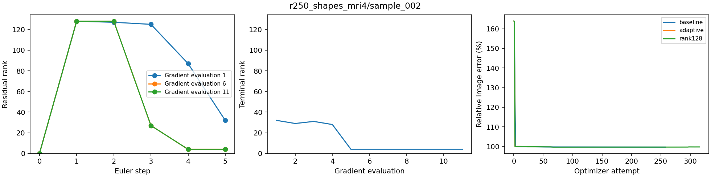
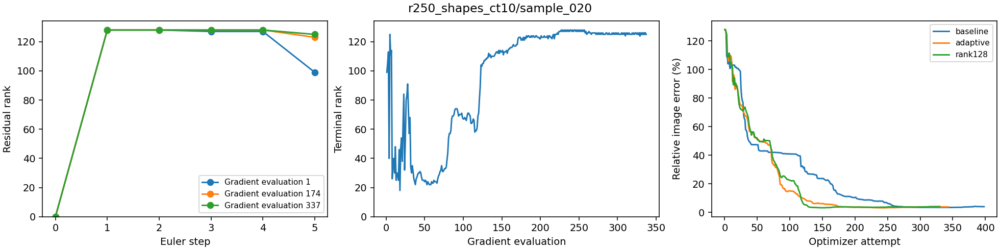
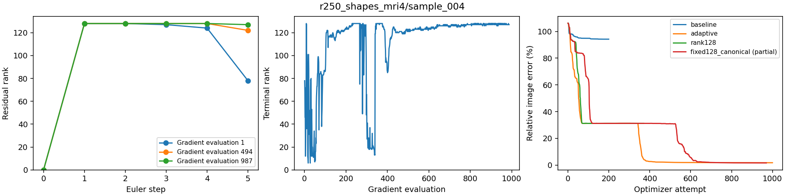
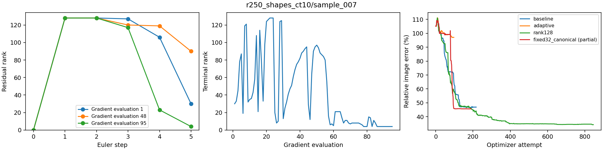

# Separated-shapes adaptive-rank pilot
Updated 2026-10-22T02:36-04:00.

Paired noiseless CT10/MRI4× cases; 117k models, five Euler steps, analytical alpha=1-t, native forward normalization, zero enrichment, and the same LBFGS/Armijo settings and 1000-attempt limit.
Adaptive bounds: 4–128; retain core singular values at least 0.001 times the largest, subject to these bounds. This cutoff is not a bound on gradient error.
The maximum-rank initialization sketch is rebuilt at each gradient evaluation. With zero enrichment, rank can only decrease within one flow solve; it can increase again at the next gradient evaluation.
Fixed-rank canonical controls use equal rank bounds in the adaptive code path. They help distinguish rank selection from changes in factor arithmetic and execution.

Errors below use the last saved source. Partial results are explicitly marked; these selected cases do not estimate population performance.

| Case | Variant | Status | Attempts | Relative image error | Clean measurement error |
| --- | --- | --- | ---: | ---: | ---: |
| r250_shapes_mri4/sample_002 | baseline | Complete (stalled) | 258 | 99.687% | 99.562% |
| r250_shapes_mri4/sample_002 | adaptive | Complete (stalled) | 12 | 100.040% | 100.006% |
| r250_shapes_mri4/sample_002 | rank128 | Complete (stalled) | 316 | 99.768% | 99.502% |
| r250_shapes_ct10/sample_020 | baseline | Complete (stalled) | 398 | 3.946% | 0.701% |
| r250_shapes_ct10/sample_020 | adaptive | Complete (stalled) | 343 | 3.742% | 0.572% |
| r250_shapes_ct10/sample_020 | rank128 | Complete (stalled) | 330 | 3.999% | 0.521% |
| r250_shapes_mri4/sample_004 | baseline | Complete (stalled) | 199 | 94.224% | 93.707% |
| r250_shapes_mri4/sample_004 | adaptive | Complete (step_limit) | 1000 | 1.743% | 0.999% |
| r250_shapes_mri4/sample_004 | rank128 | Complete (stalled) | 370 | 31.235% | 30.091% |
| r250_shapes_mri4/sample_004 | fixed128_canonical | Partial (running) | 970 | 1.602% | 0.902% |
| r250_shapes_mri4/sample_004 | fixed32_canonical | Pending | — | — | — |
| r250_shapes_ct10/sample_007 | baseline | Complete (stalled) | 217 | 46.905% | 28.573% |
| r250_shapes_ct10/sample_007 | adaptive | Complete (stalled) | 97 | 97.082% | 74.187% |
| r250_shapes_ct10/sample_007 | rank128 | Complete (stalled) | 846 | 34.280% | 20.199% |
| r250_shapes_ct10/sample_007 | fixed32_canonical | Partial (running) | 190 | 45.631% | 29.501% |

Completed 12/15 method runs.
All available variants within each case have matching initial-source and checkpoint hashes.

## r250_shapes_mri4/sample_002

Last recorded flow ranks: 0 → 128 → 128 → 27 → 4 → 4.

## r250_shapes_ct10/sample_020

Last recorded flow ranks: 0 → 128 → 128 → 128 → 128 → 125.

## r250_shapes_mri4/sample_004

Last recorded flow ranks: 0 → 128 → 128 → 128 → 128 → 127.

## r250_shapes_ct10/sample_007

Last recorded flow ranks: 0 → 128 → 128 → 117 → 23 → 4.

