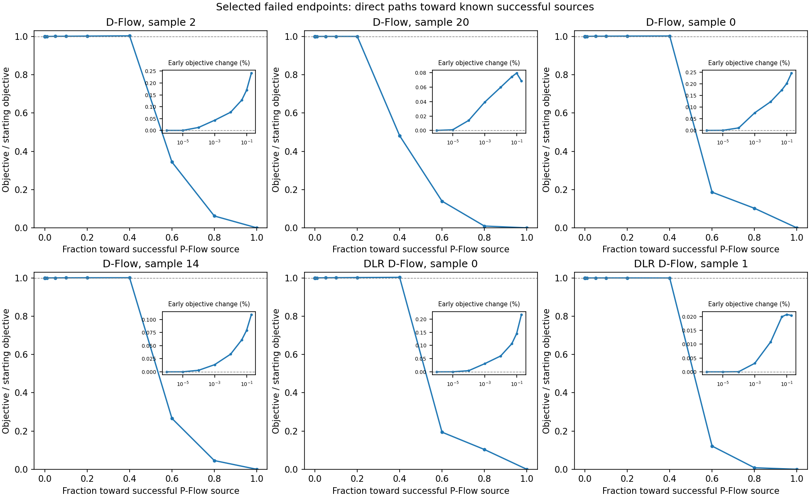

# Objective geometry at failed sources

Lowest-index D-Flow failure above 50% per object count, plus corrected native DLR cases 0/1. Retrospective selected-case diagnostics; no optimizer updates.

All cases use the same 250² MRI4× acquisition and five-step generator as their successful paired P-Flow endpoint. The diagnostic promotes the saved model/source to FP64 while preserving the original FP32 time features. No reconstruction updates or new optimizer are tested.

| Failed method | Sample | Starting image error | Exact gradient norm | Largest tested negative-gradient displacement that decreases loss | Maximum sampled bridge rise | Target image error |
|---|---:|---:|---:|---:|---:|---:|
| D-Flow | 2 | 99.724% | 204.4 | 1e-05 | 0.3754% | 3.597% |
| D-Flow | 20 | 100.044% | 5.572 | 1e-06 | 0.0794% | 2.761% |
| D-Flow | 0 | 99.845% | 1.798 | 1e-07 | 0.2982% | 2.229% |
| D-Flow | 14 | 99.851% | 34.82 | 1e-06 | 0.1311% | 1.760% |
| DLR D-Flow | 0 | 99.741% | 36.31 | 1e-06 | 0.3382% | 2.229% |
| DLR D-Flow | 1 | 100.021% | 0.7412 | 1e-07 | 0.0207% | 2.375% |

The displacement column is the largest decreasing step among the explicitly sampled lengths, not a certified line-search limit. The bridge rise is relative to each starting objective. A rise along this straight path does not exclude another descending path.

Native gradient slopes agree with central differences at displacement 1e-8: maximum absolute slope error divided by exact gradient norm is 3.8e-06. Saved FP32 endpoint recomputation agrees; promoting to FP64 changes endpoint values by up to 0.451% relative to the original endpoint. All promoted successful targets remain below 10% image error.

## Interpretation

The failed endpoints have nonzero exact gradients. A first-order descending direction need not decrease the objective at a larger finite displacement: higher-order curvature can dominate. The observed sign changes at very small displacements support a narrow local descent region. They do not establish a global stationary point or a specific layer as the cause.

All sampled bridges rise above their starting objective before reaching a successful endpoint. The same discrete generator can represent useful images, but optimization from a failed endpoint encounters unfavorable local geometry. P-Flow's earlier successful trajectory does not imply that its proxy direction is a descent direction at the failed source; several measured exact/proxy cosines are negative.

For DLR this separates two problems: missing useful directions and navigating the actual objective even when a direction is accurate. More rank can address the first without fixing the second. A blanket terminal-rank increase is therefore not a sufficient correction. Existing source-initialization and preserved-state optimizer controls remain the relevant reconstruction tests; this diagnostic does not justify a new default or relaxed acceptance criterion.

[Full measurements](source_bridge_refined.json)
