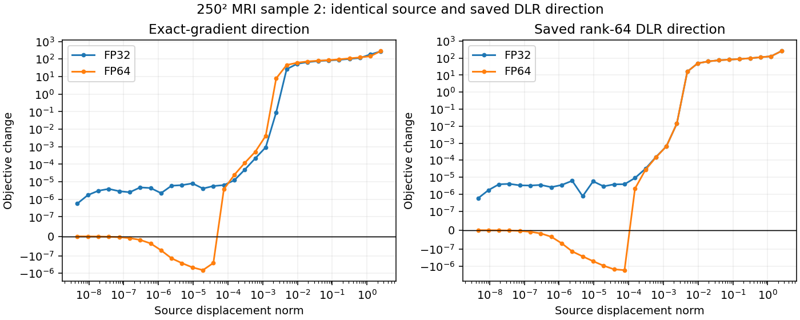

# Adaptive rank: source selection and precision controls

All cases are selected noiseless failures, not a population estimate. Preserve the trained 117k model, five Euler steps, alpha=1-t, no trace probes or enrichment, geometric Armijo, and the original 1000-attempt budget. MRI uses 4x Cartesian undersampling; CT uses 10 angles. No image-error-based source or checkpoint selection.

## Paired source pools

Four identical cached sources per control receive up to 50 probes each; the lowest measurement loss selects the continuation. Rejected-search safeguards remain active.

| Case | Fixed rank 128 image error | Adaptive 32–128 image error | Fixed / adaptive measurement residual |
| --- | ---: | ---: | ---: |
| 250² MRI sample 2 | 3.155% | 11.659% | 1.592% / 7.848% |
| 200² CT sample 1 | 30.332% | 27.583% | 13.780% / 13.146% |

Both select the half measurement-adjoint mixture. Adaptive runs use 235 and 233 total attempts, including discarded probes. Sources, data, masks, models, seeds and source-pool budgets are paired. MRI retains right-basis reuse; CT preserves its earlier no-reuse control. Adaptive truncation diagonalizes intermediate cores; fixed fast arithmetic skips those SVDs. This comparison does not isolate rank selection from the associated floating-point arithmetic.

[Paired comparisons and figures](../multistart_adaptive_report/report.md) · [Protocol checks](../multistart_adaptive_protocol_verification.json)

## Is the failed adaptive endpoint simply too low-rank?

At the same failed MRI source, increasing the adaptive floor improves the gradient:

| Floor (maximum 128) | Relative gradient error, reused V | Cosine with exact gradient |
| --- | ---: | ---: |
| 32 | 62.9% | 0.805 |
| 64 | 24.5% | 0.970 |
| 128 | 22.9% | 0.974 |

Nevertheless, equally cold optimizer restarts with floors 32, 64 and 128 all terminate at **11.659%** image error. They retain the parent source, right basis and original attempt counters; no extra total budget is granted. At the CT endpoint, even floor128 leaves approximately96% gradient error, so a CT rank-increase reconstruction was not launched.

The floor64 saved endpoint captures95.04% of the exact FP32 gradient's squared norm, with cosine0.97094. A more accurate gradient alone does not guarantee a numerically resolvable objective decrease.

[Rank-recovery verification](../adaptive_rank_recovery_mri2/verification.json) · [Rank-recovery results](../adaptive_rank_recovery_mri2/summary.json)

## Same-direction precision audit

Use the identical saved source, weights, measurements, mask and FP32 DLR direction. In the FP64 audit, promote the source and weights; preserve the trained FP32 sinusoidal features before promoting the time-projection input. This changes forward arithmetic throughout the generator, not merely the scalar loss reduction. DLR factors are not recomputed for this fixed-direction comparison.

| Quantity | FP32 | FP64 |
| --- | ---: | ---: |
| Objective | 1.06437554 | 1.06437847 |
| Exact-gradient norm | 0.0588825 | 0.0619694 |
| Saved DLR direction cosine | 0.97094 | 0.95662 |
| Best tested DLR-direction objective change | +5.71e-7 | -1.744e-6 |
| True-slope Armijo trials accepted | 0 | 15 |

The best FP64 DLR-direction displacement is7.629e-5. The exact-gradient direction also finds no decreasing FP32 trial but does in FP64. Full-map adjoint consistency is6.39e-5 in FP32 and1.58e-15 in FP64. The tested directions include 30 geometrically halved displacement norms from the original cap2.5; this is a fixed-point probe, not a reconstruction or a claim that every possible FP32 step fails.

For a normalized descent direction, the local change is approximately minus displacement times the directional slope plus one half the squared displacement times directional curvature. A positive gradient cosine establishes descent in exact arithmetic; it does not put the resulting decrease above forward-roundoff error. Here higher precision exposes a small decrease. Whether that leads to an accurate solution still requires a continuation test.

A paired native-autodiff FP32/FP64 continuation is running for up to50 additional attempts from the floor64 parent. Both reset curvature and preserve the same source, right basis, initialization, adaptive64–128 bounds and original remaining budget. The 150 attempts spent on discarded sources remain charged to each arm. No informed seed is introduced.

[Continuation protocol](../native_precision_recovery_mri2_floor64/config.json) · [Live continuation results](../native_precision_recovery_mri2_floor64/summary.json) · [FP32 audit](mri2_floor64_precision_fp32.json) · [FP64 audit](mri2_floor64_precision_fp64.json)

The separate three-object MRI4 retained-seed precision control is complete: FP64 improves image error94.224% to73.720% by the original1000-attempt cap, still inaccurate. Precision is a demonstrated obstacle to progress at some endpoints, not a sufficient general accuracy correction. [Completed MRI4 evidence](mri4_precision_report.md).
