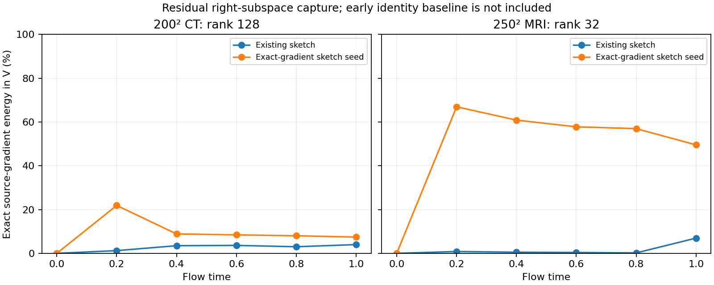

# Failed-source backend and informed-sketch recovery

Updated 2026-10-22 07:05 local time. All controls below are complete on GPU 1. No production default changed.

## Backend check at failed sources

The same factor integrator, rank, seed and initial right basis are evaluated with accelerated derivatives and independent native-autodiff products. This extends the earlier random-start checks to actual optimized failure states.

| Source | Rank | Reused V | Backend difference / DLR gradient | Backend difference / exact gradient | Native-DLR gradient error |
| --- | ---: | --- | ---: | ---: | ---: |
| ct1_failed_backend | 128 | False | 0.01673% | 0.00355% | 98.954% |
| mri1_failed_backend | 32 | False | 0.04924% | 0.00530% | 101.563% |
| mri1_failed_backend | 32 | True | 0.00162% | 0.00008% | 100.197% |
| mri1_failed_backend | 128 | False | 0.04242% | 0.00603% | 100.211% |
| mri1_failed_backend | 128 | True | 0.18515% | 0.02248% | 99.024% |

The maximum backend difference is 0.185% of the DLR gradient norm and 0.0225% of the exact-gradient norm. Both backends retain essentially the same large approximation error. This does not eliminate long-trajectory sensitivity to roundoff, but it rules out backend disagreement as the dominant local gradient error at these sources.

## One exact source-gradient seed

The fixed-point oracle replaces one existing initialization-sketch column with the exact source gradient. Rank, sketch width, analytical alpha, and subsequent factor updates stay unchanged. MRI rank 32 with reused V improves cosine −0.0148 to 0.6912 and gradient error 100.197% to 73.823%; terminal captured squared-gradient norm increases 6.954% to 49.539%. CT rank 128 gradient error remains about 99%. The exact-gradient column is an oracle diagnostic, not a cost-free approximation.

This plot measures the final objective gradient in the residual right subspace at each flow time. It excludes the early alpha-I contribution and is not a claim that the full sensitivity loses all directions at t=0. Internal callback alpha has roundoff at t=1; the returned terminal alpha is exactly zero.

For reconstruction, compute the source gradient once at the failed parent and freeze that vector for every later initialization. No exact-gradient optimizer steps are taken. Compare against an unchanged cold restart and a fixed random direction with the same norm. All arms preserve the parent source, right basis, data, rank, model, optimizer settings and remaining original 1000-attempt cap. Clear curvature equally across the three arms because the estimator changes. Ground truth never chooses a seed or a continuation.

| Parent | Seed control | Final image error | Measurement residual | Total attempts including prior starts |
| --- | --- | ---: | ---: | ---: |
| frozen_seed_recovery_200ct1 | unchanged | 25.790% | 13.221% | 247 |
| frozen_seed_recovery_200ct1 | gradient_seed | 25.792% | 13.221% | 286 |
| frozen_seed_recovery_200ct1 | random_seed | 25.790% | 13.221% | 247 |
| frozen_seed_recovery_mri1 | unchanged | 12.306% | 6.833% | 200 |
| frozen_seed_recovery_mri1 | gradient_seed | 9.040% | 5.333% | 576 |
| frozen_seed_recovery_mri1 | random_seed | 12.306% | 6.833% | 199 |
| refreshed_seed_recovery_mri1 | unchanged | 9.040% | 5.333% | 578 |
| refreshed_seed_recovery_mri1 | gradient_seed | 9.040% | 5.333% | 578 |
| refreshed_seed_recovery_mri1 | random_seed | 9.040% | 5.333% | 578 |

The first informed seed improves MRI 12.306% to 9.040%, while the matched random control stays 12.306%. It does not improve CT. A second exact-gradient refresh at the new MRI endpoint makes no further progress; its unchanged control retains the old frozen seed, with the same curvature reset and remaining budget. One or two exact full-map gradients are additional work, explicitly recorded in the configs. This is a partial selected-case improvement, not a general accuracy correction.

## Why the refreshed MRI direction cannot make useful progress

The final saved rank 32 basis captures 43.776% of the exact gradient squared norm. Split the exact gradient into its orthogonal projection onto V and its complement. At displacement 2.5:

| Direction | Objective change | Image error after trial |
| --- | ---: | ---: |
| Exact gradient | -0.045975 | 8.948% |
| Exact component inside V | -0.001859 | 9.126% |
| Exact component outside V | -0.047360 | 8.904% |
| Saved DLR gradient | 0.046369 | 9.192% |

These are candidate evaluations at one fixed source, not additional accepted optimizer updates. Neither sign of the saved DLR gradient accepts an Armijo step among 30 halved displacements. The excluded exact-gradient component offers a useful decrease in both loss and image error.

For a unit direction d, native full-map JVPs give the local Gauss-Newton curvature ||A J d||². This is the curvature of the linearized residual model, not the full nonlinear Hessian:

| Direction | Gauss-Newton curvature | Linearized optimal displacement | Linearized best loss decrease |
| --- | ---: | ---: | ---: |
| exact | 53.6797 | 0.000660129 | 1.1696e-05 |
| inside | 87.5216 | 0.000267878 | 3.14022e-06 |
| outside | 2.29969 | 0.011554 | 0.000153498 |
| saved_dlr | 233.991 | 8.35484e-05 | 8.16665e-07 |

The saved DLR direction has about 102 times the Gauss-Newton curvature of the excluded direction. Its linearized best decrease is 8.17e-7, whereas the actual tiny-step FP32 objective changes fluctuate at a few 1e-6. This supports a local mechanism: approximation error places weight on stiff directions, while useful lower-sensitivity directions are excluded. Large nonlinear steps need not follow this local quadratic model, as the trial table demonstrates. Correcting coefficients inside V helps much less than retaining the excluded component at this source.

Fourteen CPU checks pass, including frozen-seed state handling with and without basis reuse and restoration after an exception. Completed reconstruction metrics, seed hashes/norms, original-history prefixes, objective nonincrease, and budgets are independently verified. Production defaults remain unchanged. A general correction still needs evidence beyond these selected points.

[Verification](seed_recovery_verification.json) · [Directional geometry and trials](mri1_refreshed_seed_geometry.json) · [CT native comparison](ct1_failed_backend.json) · [MRI native comparison](mri1_failed_backend.json)

Endpoint panels: [MRI unchanged](../frozen_seed_recovery_mri1/unchanged/comparison.png), [MRI informed seed](../frozen_seed_recovery_mri1/gradient_seed/comparison.png), [CT unchanged](../frozen_seed_recovery_200ct1/unchanged/comparison.png), [CT informed seed](../frozen_seed_recovery_200ct1/gradient_seed/comparison.png). Other methods are explicitly marked unavailable in these endpoint controls.
