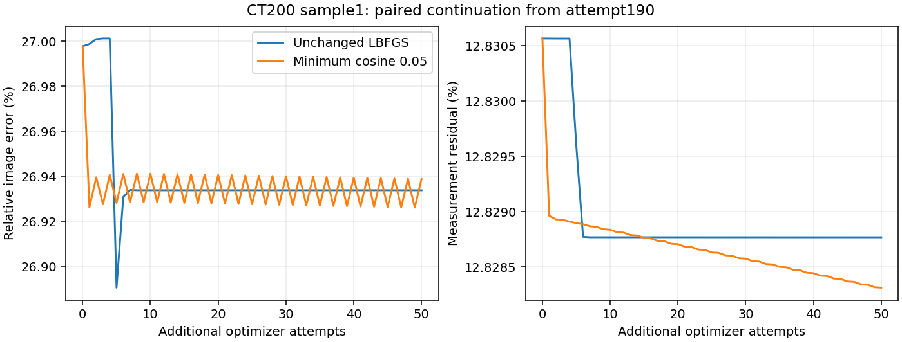

# L-BFGS amplification of a small DLR gradient error

At saved CT200 sample1, prefix3 initialization, fixed rank128, FP64 and attempt190, the DLR gradient differs from the native exact gradient by1.3426%, with cosine0.999930. Nevertheless, the saved49-pair L-BFGS history produces a direction nearly perpendicular to exact descent. Its unit-direction true slope is -3.0052e-6, versus the predicted -1.5466e-4: about51.5 times less first-order decrease than predicted.

The native GPU audit reproduces the saved endpoint and objective exactly. Central differences confirm the true directional derivative. CPU checks independently show the same mechanism but differ slightly in endpoint and slope; the GPU numbers are used here. This is a fixed-state explanation of weak progress, not evidence that every L-BFGS history or every failure has this cause.

## A cheap direction safeguard

Write the approximate gradient as \(\hat g\), true gradient as \(g\), and proposed direction as \(p\). A minimum descent cosine \(\eta\) enforces

\[
-\hat g^\top p\geq\eta\|\hat g\|\|p\|.
\]

If \(\|g-\hat g\|<\eta\|\hat g\|\), Cauchy-Schwarz gives

\[
g^\top p
=\hat g^\top p+(g-\hat g)^\top p
\leq[-\eta\|\hat g\|+\|g-\hat g\|]\|p\|<0.
\]

The experimental helper rotates a direction only when its angle violates the bound, preserving its norm and perpendicular orientation. It keeps L-BFGS history, proposed length, displacement cap and objective-based Armijo acceptance. It requires only vector operations; no additional model derivatives or exact gradients enter the safeguard. The inequality is a sufficient condition, not an online certificate: the approximation error is unknown during reconstruction. The current implementation supports unconstrained sources only.

## Same-state Armijo trials

| Minimum cosine | True unit-direction slope | Accepted displacement | Accepted objective decrease | Trial evaluations |
|---|---:|---:|---:|---:|
| 0 | -3.00522e-06 | 0.00128665 | 1.18137e-09 | 10 |
| 0.05 | -0.00939135 | 0.00128665 | 5.20942e-06 | 10 |
| 0.1 | -0.0189357 | 0.000643325 | 5.07885e-06 | 11 |

The0.05 safeguard gives roughly4409 times the objective decrease at the same10-trial count in this one diagnostic. This is not a speed or reconstruction-success claim. Native endpoints/objectives match, and finite differences validate all three slopes. Two CPU tests cover300 randomized cases of preserved norm, minimum angle, unchanged valid directions and strict descent under a bounded gradient error, plus degenerate/antiparallel directions. No production setting is changed; a paired reconstruction is still required.

A separate CPU snapshot of MRI2 at attempt540 has37.32% gradient error and retains about78% of its predicted directional decrease. It does not show the same severe slope cancellation; no GPU-equivalent claim is made for that CPU result.

[Native GPU direction](ct1_lbfgs_direction_gpu.json) · [Unchanged Armijo](ct1_direction_angle0.json) · [Cosine0.05](ct1_direction_angle0.05.json) · [Cosine0.1](ct1_direction_angle0.1.json) · [CPU MRI snapshot](mri2_lbfgs_direction_cpu.json).

## Paired reconstruction in progress

The preserved-state branch is now running. To avoid spending the full remaining budget on a nearly stationary baseline before testing a correction, the baseline process is suspended in memory while the angle and cap-started controls execute sequentially; it resumes automatically afterward. It starts from the exact audited attempt190 snapshot, preserving source, gradient,49 curvature pairs, right basis, history and counters. Only the minimum direction cosine changes to0.05. The existing prefix3 trajectory supplies the unchanged baseline; its full history prefix matches the snapshot. Both have the original1000-total-attempt cap (888 selected-source plus112 earlier discarded-source attempts). The new branch can use698 remaining selected-source attempts. Compare common completed prefixes and report early terminations separately.

The priority coordinator validates process identity and input/code hashes, and restores the baseline on success or failure. CPU tests exercise both exit paths. The first actual angle-safeguarded update reproduces the fixed-state trial displacement, ten evaluations and objective decrease within1e-12. The history prefix and factor settings are unchanged; saved image/residual metrics recompute correctly at attempt195. The result is still partial. [Queue configuration](../direction_recovery_ct1_cos005/queue.json).

[Priority schedule](../priority_recovery_plan.json) · [Initial reconstruction verification](../direction_recovery_ct1_cos005/start_verification.json).

## First50 paired reconstruction updates

Both arms share the complete saved prefix through attempt190 and are compared at240. Unchanged L-BFGS ends at26.9338% image error and12.8288% residual; minimum cosine0.05 ends at26.9388% and12.8283%. The image result is slightly worse, not an accuracy improvement. Objective decreases are5.842e-6 versus7.322e-6, while line-search objective evaluations are118 versus598. Thus the large one-step improvement did not translate to a useful50-update reconstruction advantage. This does not justify adopting the angle safeguard.

The full-budget angle run remains active; this is a common-prefix comparison, not its final result. The cap-started control is still pending. [Recorded comparison](../direction_recovery_ct1_cos005/comparison_first050.json).

## First100 paired reconstruction updates

At attempt290, unchanged versus safeguarded image errors are26.933785% and26.933439%; the difference is only0.000346 percentage points. Residuals are12.828768% and12.827640%. The safeguard has used1201 line-search objective evaluations versus168. This extends the negative practical result: no meaningful image advantage has appeared after100 matched updates. The full-budget run remains active; this is not its final outcome.

[Recorded100-update comparison](../direction_recovery_ct1_cos005/comparison_first100.json) · [Convergence figure](../direction_recovery_ct1_cos005/comparison_first100.png).
