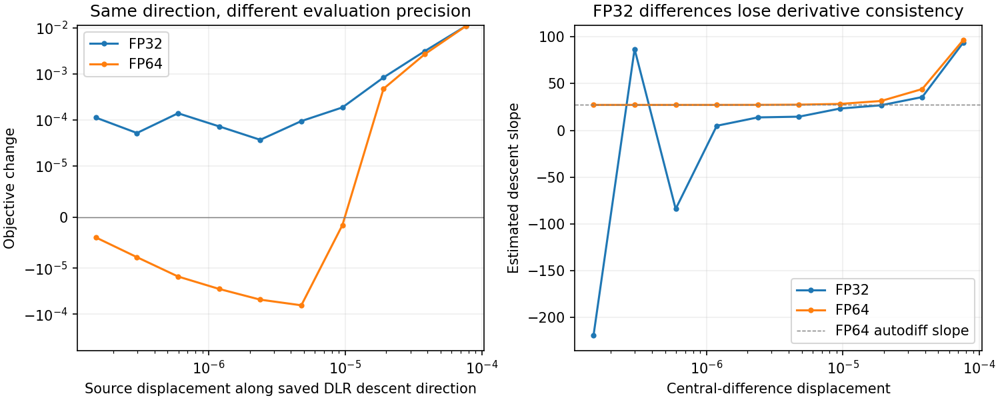

# Three-object MRI failure: precision and stiffness

Retaining the informed seed does not lose most of the source gradient here: rank32 retains81.69% of its squared norm at the terminal time, with cosine0.894 and relative error44.84%. Nevertheless, the FP32 continuation cannot find a useful accepted step. This differs from the CT case, where the next KSL update discards most of the seed.

## Fixed-source precision control

Use the same saved source, weights, MRI mask, measurements and saved FP32 DLR direction. Evaluate the original five-step generator in native FP32 and native FP64; promote the existing FP32 sinusoidal features before the time-projection layer. This preserves the trained parameter values and time features. It changes arithmetic throughout the forward map, not merely the final scalar reduction. The FP64 audit does not recompute DLR factors: its saved direction and V are promoted from FP32.

| Quantity | FP32 | FP64 |
| --- | ---: | ---: |
| Objective |1369.175659|1369.175708|
| Exact-gradient norm |15.2515|33.7530|
| Cosine of saved DLR direction with exact gradient |0.8942|0.8063|
| Best measured objective change along DLR descent |+0.00003296|-0.00006407|
| Best FP64 trial displacement |—|0.000004768|

The exact gradient itself is precision-sensitive at this source, although objective values are close. Independent full-map JVP/VJP consistency in FP64 is2.62e-15. Therefore backend agreement within FP32 does not establish agreement with the higher-precision mathematical map.

In FP64, central differences converge to the autodiff descent slope27.2137. The directional second derivative stabilizes near5.888e6, implying a local quadratic optimum near4.62e-6 displacement and6.29e-5 decrease. This agrees with the actual tested decrease. It is the full finite-difference curvature, unlike the lower Gauss-Newton curvature1.441e6; the nonlinear residual term matters. FP32 finite differences become erratic at these displacements.

This establishes a numerical obstacle to local progress. It does not establish that removing it yields an accurate reconstruction.

## Paired reconstruction control

Both continuations use native autodiff products, the same rank32, frozen informed seed, right basis, source, measurements, five-step map, retained initialization and later KSL formulas. Both cold-reset curvature and retain the original attempt counter201 and geometric Armijo/cap settings. Each precision recomputes its own initial objective. No new exact-gradient seed is computed. The first segment is bounded to50 additional attempts, inside the original1000-attempt budget.

The native FP32 control terminates at205 attempts with94.224% image error. FP64 completes the first50 additional attempts at251 total, with94.039% image error and objective1363.35054 versus its initial1369.17571. This is a small image improvement, not an accuracy rescue. Completed saved-array metrics and monotonicity pass ([segment verification](../native_precision_recovery_mri4/segment_050_verification.json)). Because it remains active at the segment limit, resume with its source, gradient, right basis, curvature pairs and attempt count preserved, up to the original1000-attempt limit. The rejected-search safeguard remains in force; the FP32 control is not restarted. Final FP64 accuracy is pending. This tests numerical recovery, not a proposed speed improvement. Production defaults and the source-review hold are unchanged.

[Reconstruction status](../native_precision_recovery_mri4/summary.json) · [Protocol](../native_precision_recovery_mri4/config.json) · [FP32 trials](mri4_retained_seed_geometry.json) · [FP64 trials](mri4_retained_seed_geometry_fp64.json) · [Central differences](mri4_precision_finite_differences.json) · [Factor capture audit](mri4_retained_seed.json)
