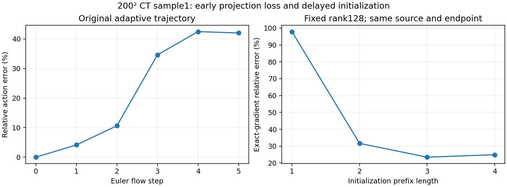

# Early projection loss in a failed CT reconstruction

This is a fixed-source diagnostic of the completed200² CT10 sample1 adaptive source-pool run (27.583% image error), not a new population result. Use the same source, native FP64 generator, five Euler steps, data and exact terminal/source gradients. The existing independent autodiff validation remains in place.

## Error along the flow

With analytical alpha=1-t, compare the exact discrete sensitivity

\[
J_{n+1}=(I+hA_n)J_n
\]

to the DLR approximation

\[
\widehat J_n=\alpha_n I+U_nS_nV_n^\top.
\]

Eight independent Rademacher vectors estimate their relative Frobenius-action error. These diagnostic vectors do not enter initialization, KSL, rank selection, or alpha estimation; this is not trace-alpha probing. The estimates are not certified matrix norms or rank estimates.

| Flow step | DLR rank | Estimated relative Jacobian error | Terminal source-gradient energy retained in V |
| --- | ---: | ---: | ---: |
| 1 | 128 | 4.14% | 21.39% |
| 2 | 128 | 10.62% | 8.57% |
| 3 | 128 | 34.62% | 9.09% |
| 4 | 32 | 42.47% | 12.21% |
| 5 | 32 | 42.01% | 19.05% |

The error grows to34.62% while rank is still128. The final reduction to32 is therefore not the sole origin of the error. Terminal exact-gradient error is98.52%, much larger than the estimated matrix-action error42.01%; an acceptable aggregate matrix approximation need not preserve the direction required by this measurement loss.

For the residual ODE field

\[
F(t,Y)=A_t(Y+\alpha_t I)+I,
\]

we also measure its component outside the current rank manifold's tangent space:

\[
(I-UU^\top)F(t,Y)(I-VV^\top)
=(I-UU^\top)(\alpha_tA_t+I)(I-VV^\top).
\]

At steps1/2/3/4, its estimated norm divided by the full field norm is98.39%/55.42%/5.91%/0.95%. This is evaluated at the approximate residual, not an exact local truncation-error certificate. Early field components are poorly represented even though the stored core has128 singular directions. A rank cutoff that only examines that core cannot detect directions already omitted. At step0 the zero residual needs initialization; the normal-block ratio there is trivially one and is not a failed KSL step.

The simplified normal-block action matches direct dense matrices in nine checks spanning ranks1/3/full and alpha1/.6/0. The public terminal alpha is exactly0; the intermediate factor callback records a5.55e-17 subtraction remainder at the last point, within roundoff.

## Delayed initialization check

The existing Gaussian exact-prefix initializer can postpone the first residual truncation. Compare prefix lengths1–4 at fixed rank128 with the same Gaussian sketch seed, source, endpoint and terminal gradient. Length3 retains two ordinary factor-evolution steps; length4 retains one. This changes the initialization interval, not the later KSL projection. The initial attempt to combine this initializer with adaptive rank was rejected by its existing API guard; the following controls explicitly use fixed rank.

| Initialization prefix | Exact-gradient relative error | Cosine | Coefficient error | Subspace error |
| --- | ---: | ---: | ---: | ---: |
| 1 | 97.94% | 0.21355 | 39.63% | 89.56% |
| 2 | 31.63% | 0.96187 | 17.29% | 26.48% |
| 3 | 23.43% | 0.97230 | 5.71% | 22.73% |
| 4 | 24.91% | 0.96953 | 9.64% | 22.96% |

The step3 initializer substantially improves the gradient here. Length4 is slightly worse, so later initialization is not automatically better. All endpoints are bitwise identical; accelerated/native factor-gradient differences are below2.3e-12. The initial Gaussian sketch is paired across these four controls; the earlier adaptive diagnostic uses its original Rademacher startup and is not a matched one-variable control for these rows.

Paired FP64 reconstruction continuations now compare prefix1 and prefix3 from the same failed source. Both use fixed rank128, the original optimizer and right-basis-reuse setting, cold optimizer histories, and up to50 additional attempts charged against the original1000-attempt total. The two arms run sequentially. Both segments are complete. Prefix1 ends at27.5825% image error and13.1456% residual; prefix3 ends at27.3367% and12.8943%. This is a modest improvement, not an accuracy rescue. Both used50 additional attempts (283 total including earlier source probes). [Saved-array verification](../prefix_recovery_200ct1/segment_050_verification.json) · [Convergence](../prefix_recovery_200ct1/segment_050_convergence.png).

[Prefix diagnostic](ct1_fp64_prefix_defect.json) · [Dense algebra check](prefix_defect_algebra_check.json) · [Prefix1](ct1_fp64_prefix1.json) · [Prefix2](ct1_fp64_prefix2.json) · [Prefix3](ct1_fp64_prefix3.json) · [Prefix4](ct1_fp64_prefix4.json)
