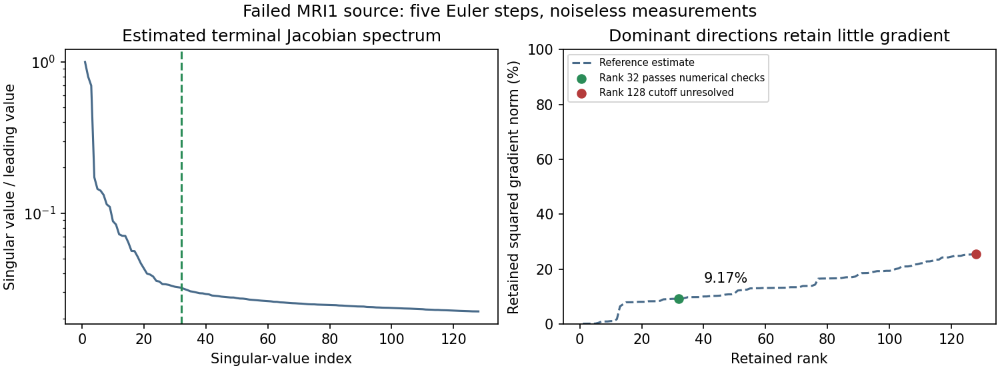

# Why spectral low rank can discard a useful reconstruction gradient

At the saved rank32 MRI1 reconstruction (12.306% image error), the rank32 native full-map SVD reference now passes the numerical checks. The map is the actual five-step Euler generator at that fixed source. The native full-map products are independently checked against backpropagation, and a small nonlinear model test compares the compressed-SVD construction with a dense Jacobian SVD.

| Quantity | Rank32 reference | Rank128 reference |
| --- | ---: | ---: |
| Gradient relative error | 95.306% | 87.206% |
| Maximum two-sided singular-triplet residual / leading singular value | 2.480e-6 | 1.640e-3 |
| Last refinement change / exact-gradient norm | 1.473e-5 | 2.481e-2 |
| Estimated cutoff gap / leading singular value | 6.070e-4 | 4.936e-5 |
| Numerical reference checks | Pass | Fail; cutoff unresolved |

The rank128 error remains provisional. Passing numerical checks is not a formal global spectral certificate. The independent reference uses136 sketch columns and12 power iterations. A completed wider256-column reference reproduces the rank32 gradient error at95.306%. Its triplet residual is1.274e-6, last gradient change3.456e-6 and cutoff gap6.071e-4; rank32 passes again. Rank128 still fails: its provisional gradient error is86.311%, last gradient change1.729%, and the cutoff remains unresolved. Neither reference changes DLR initialization or any reconstruction.

The leading singular value is1.04879; the rank32/33 values are0.0337125/0.0330758. The next singular value is only3.154% of the leading value, yet truncating there removes most of the current source gradient. Rank32 retains approximately9.167% of its squared norm. Ordinary reused-basis DLR at the same source has100.197% gradient error; the separate goal-oriented terminal projection has17.834%. These are fixed-point comparisons, not reconstruction trials.

## Algebra

For the real generator Jacobian and its singular vectors,

\[
J=\sum_i\sigma_i u_i v_i^\top,\qquad
J^\top g_x=\sum_i\sigma_i(u_i^\top g_x)v_i.
\]

Truncating to the largest r singular values therefore gives

\[
\|J^\top g_x-J_r^\top g_x\|^2
=\sum_{i>r}\sigma_i^2|u_i^\top g_x|^2.
\]

A singular-value cutoff depends on sigma_i; the gradient also depends on the residual's alignment with u_i. If the current residual has little projection onto the retained left singular vectors, even a good spectral approximation can discard most of the remaining gradient. In particular,

\[
\frac{\|(J-J_r)^\top g_x\|}{\|J^\top g_x\|}
\leq\frac{\sigma_{r+1}\|g_x\|}{\|J^\top g_x\|},
\]

which need not be small when the denominator is small. This explains why a rank chosen from the Jacobian spectrum alone need not be sufficient throughout optimization. The adaptive core cutoff also only sees the current approximate residual factors, adding another approximation layer.

## Consequence for correction

This source exhibits both DLR approximation error and a limitation of dominant-singular-vector truncation itself. Improving KSL integration alone cannot make a rank32 dominant-SVD approximation recover the excluded gradient. Increasing rank, changing which directions are retained, or accepting a regularized endpoint are distinct choices with different costs and behavior. A loss-informed projection can preserve the action needed by this residual at low rank, but changes the approximation criterion and may change noise filtering.

The result is consistent with implicit regularization: omitted directions can prevent fitting noise. This noiseless fixed-point check does not identify which directions carry noise, and it does not prove that omitted directions are always undesirable. Here useful reconstruction information remains outside the retained dominant subspace.

[Raw refined reference](mri1_svd_refined12.json) · [Projection controls](task_terminal_report.md) · [Completed shared-budget comparisons](../multistart_goal_report/report.md)

[Wider reference and gradient-energy curve](mri1_svd_wide12.json). Only rank32 is accepted by the reported numerical cutoff/refinement checks; the other curve points are estimates, not separately certified cutoffs.
