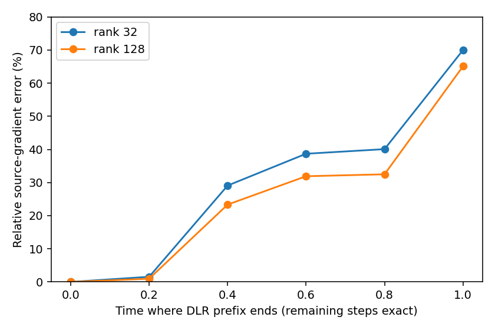

# DLR prefix / exact suffix diagnostic

At the unchanged failed250MRI4 rank128 control source (31.235% image error), compare approximate gradients against the independent native gradient of the five-step Euler map. The retained prefix uses the original DLR update and analytical alpha=1-t. Every remaining Euler step uses an exact native adjoint.

| DLR prefix steps | Exact suffix steps | Rank32 gradient error | Rank128 gradient error |
| ---: | ---: | ---: | ---: |
| 5 | 0 | 69.991% | 65.096% |
| 4 | 1 | 40.084% | 32.490% |
| 3 | 2 | 38.695% | 31.904% |
| 2 | 3 | 29.088% | 23.344% |
| 1 | 4 | 1.554% | 0.966% |
| 0 | 5 | 0.000% | 0.000% |

The rows use the saved right basis as the initialization seed. Fresh-sketch controls are retained in the JSON and show the same broad trend. Exact-full-map endpoints agree; the all-exact row recovers native backpropagation within0.001%.

For a prefix ending at step k, the hybrid gradient is the transpose of the DLR prefix Jacobian applied to the exact suffix pullback. Its error is the prefix Jacobian error acting on that pullback. The scalar baseline at the prefix is1-k/5; it is not artificially set to zero before the suffix.

This is explicitly a hybrid, not a terminal rank-r Jacobian approximation. More exact suffix steps change its regularization and make it closer to D-Flow. The one-step-suffix reconstruction is experimental; fixed-source gradient improvements do not establish image accuracy or speed.
