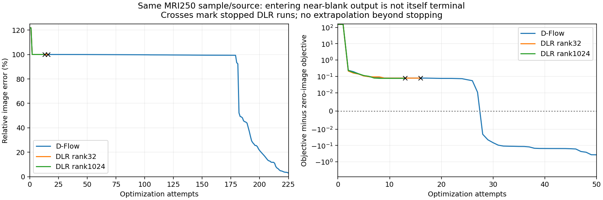

# Why the higher-rank run stopped

The paired exact D-Flow trajectory also approaches a nearly blank image by attempt2. It continues making small accepted changes, first reaches below99% image error at attempt180, below10% at214 and ends at1.219%. Rank32/1024 DLR stop at16/13 attempts under the unchanged rejection safeguard. Thus entering a nearly blank image does not by itself imply failure: the important distinction here is continued descent and subsequent recovery.

At the actual rank1024 endpoint, an independent native FP64 audit finds:

- Saved DLR gradient cosine with the exact gradient: 0.926835.
- Saved right basis retains 96.202% of the exact gradient squared norm.
- Full-map independent adjoint agrees with native backprop to 1.21e-14 relative error.
- The normalized saved negative-gradient direction decreases the FP64 objective at displacement2.5 (the existing cap), by0.16479. The exact negative-gradient direction first accepts one of the tested halvings at1.19e-6. These are different directions and discrete probes, not evidence that every intermediate length is accepted.

The optimizer actually started its final history-free trial at displacement0.62483 (saved gradient norm times learning rate1), then halved. It does not try larger lengths afterward. The original FP32 map was also checked: the cap-sized saved-gradient proposal lowers its objective by0.16478 and passes Armijo, while the cached-gradient cosine with the exact FP32 gradient is0.97744. The finite search interval therefore misses an admissible larger step at this stopping point. This does not guarantee convergence after that step. No reconstruction update or optimizer change has been made by this diagnostic. It also does not show a useful image improvement: the accepted FP64 cap probe still has approximately100% image error.

[FP64 endpoint data](rank1024_endpoint_fp64.json) · [Saved convergence histories](plateau_histories.json).

[FP32 endpoint data](rank1024_endpoint_fp32.json). Native FP32 independent-adjoint discrepancy is1.61e-5; FP32 and FP64 gradient norms differ (0.64044 versus1.60556), so precision sensitivity still exists alongside the search-interval issue.
