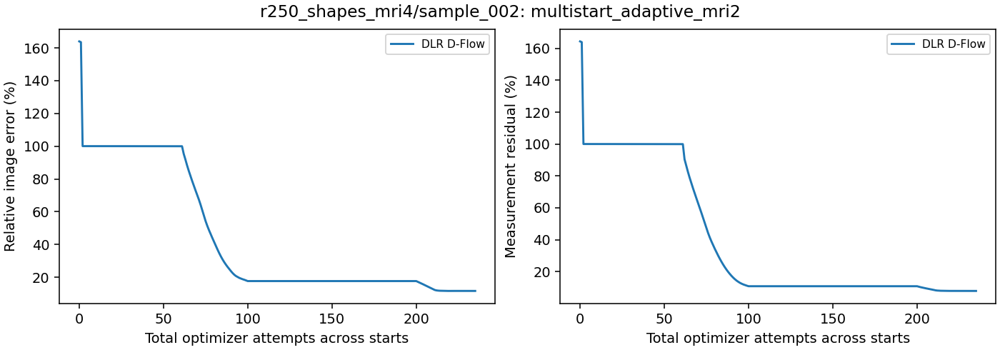
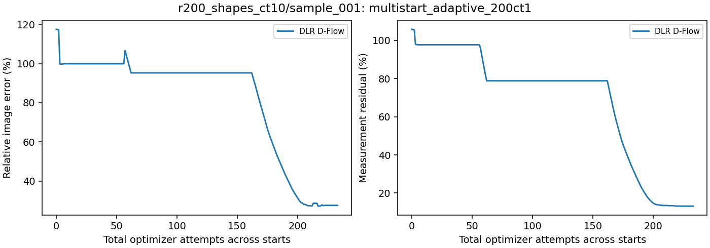

# Measurement-selected restart controls

Updated 2026-10-22T08:34-04:00.

Four cached starts per method: original Gaussian, half/full measurement-adjoint mixtures, and an independent Gaussian. Each receives up to 50 probe attempts; the lowest measurement loss selects a continuation with the remaining shared 1000-attempt budget. The selected optimizer state is preserved. Image error never selects a source.

These are selected failure cases, not a population estimate. Methods share the candidate pool but may choose different sources. Partial results are labeled.

| Case | Run | Method | DLR rank / factor update / goal steps | Selected source | Status | Total attempts | Image error | Measurement residual |
| --- | --- | --- | --- | --- | --- | ---: | ---: | ---: |
| r250_shapes_mri4/sample_002 | multistart_mri2 | D-Flow | — | measurement_half | Complete | 1000 | 1.732% | 0.225% |
| r250_shapes_mri4/sample_002 | multistart_mri2 | P-Flow | — | original | Complete | 269 | 3.597% | 1.862% |
| r250_shapes_mri4/sample_002 | multistart_mri2 | DLR D-Flow | 128 / fast / 0 | measurement_half | Complete | 892 | 3.155% | 1.592% |
| r250_shapes_mri4/sample_002 | multistart_adaptive_mri2 | DLR D-Flow | 32–128 adaptive / fast / 0 | measurement_half | Complete | 235 | 11.659% | 7.848% |
| r200_shapes_ct10/sample_001 | multistart200_ct1_fixed_sketch | D-Flow | — | measurement_half | Complete | 1000 | 12.949% | 0.004% |
| r200_shapes_ct10/sample_001 | multistart200_ct1_fixed_sketch | P-Flow | — | original | Complete | 517 | 2.602% | 0.584% |
| r200_shapes_ct10/sample_001 | multistart200_ct1_fixed_sketch | DLR D-Flow | 128 / fast / 0 | measurement_half | Complete | 282 | 30.332% | 13.780% |
| r200_shapes_ct10/sample_001 | multistart_adaptive_200ct1 | DLR D-Flow | 32–128 adaptive / fast / 0 | measurement_half | Complete | 233 | 27.583% | 13.146% |

Checks: cached source hashes, measurement-loss selection, preserved continuation history, and total attempt budgets. Completed metrics are recomputed from saved image/measurement arrays. Curves show the best measurement-loss candidate seen during probing, then the selected continuation. They do not select by image error. The factor-update column distinguishes the fast recompression, frozen-increment and two-pass refinement controls. Positive goal steps additionally change the projection criterion. These are distinguished from the notes' one-Euler-per-stage KSL core.

