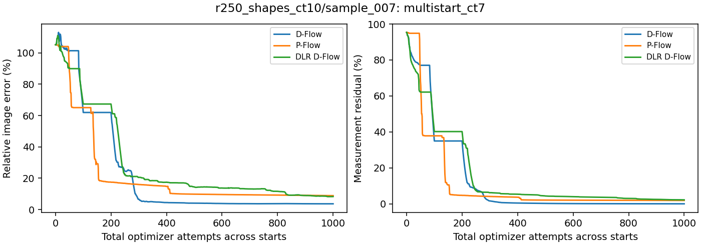
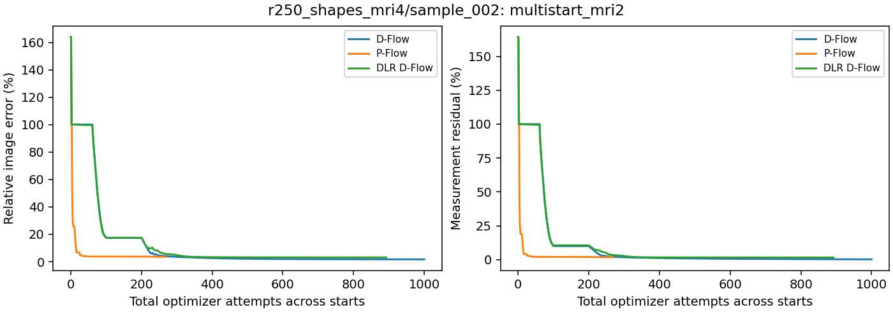
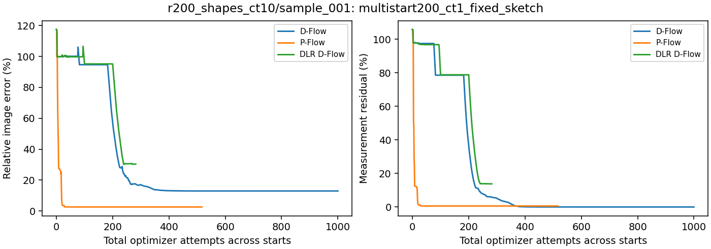
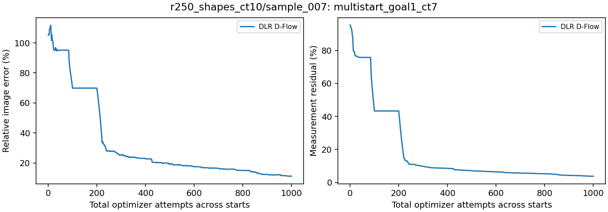
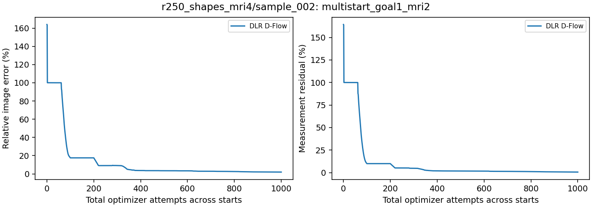
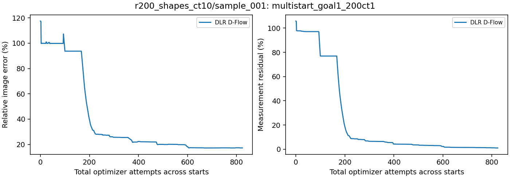

# Measurement-selected restart controls

Updated 2026-10-22T05:43-04:00.

Four cached starts per method: original Gaussian, half/full measurement-adjoint mixtures, and an independent Gaussian. Each receives up to 50 probe attempts; the lowest measurement loss selects a continuation with the remaining shared 1000-attempt budget. The selected optimizer state is preserved. Image error never selects a source.

These are selected failure cases, not a population estimate. Methods share the candidate pool but may choose different sources. Partial results are labeled.

| Case | Run | Method | DLR rank / goal steps | Selected source | Status | Total attempts | Image error | Measurement residual |
| --- | --- | --- | --- | --- | --- | ---: | ---: | ---: |
| r250_shapes_ct10/sample_007 | multistart_ct7 | D-Flow | — | measurement_half | Complete | 1000 | 3.665% | 0.034% |
| r250_shapes_ct10/sample_007 | multistart_ct7 | P-Flow | — | independent | Complete | 1000 | 8.869% | 1.907% |
| r250_shapes_ct10/sample_007 | multistart_ct7 | DLR D-Flow | 128 / 0 | measurement_half | Complete | 1000 | 8.298% | 2.232% |
| r250_shapes_mri4/sample_002 | multistart_mri2 | D-Flow | — | measurement_half | Complete | 1000 | 1.732% | 0.225% |
| r250_shapes_mri4/sample_002 | multistart_mri2 | P-Flow | — | original | Complete | 269 | 3.597% | 1.862% |
| r250_shapes_mri4/sample_002 | multistart_mri2 | DLR D-Flow | 128 / 0 | measurement_half | Complete | 892 | 3.155% | 1.592% |
| r200_shapes_ct10/sample_001 | multistart200_ct1_fixed_sketch | D-Flow | — | measurement_half | Complete | 1000 | 12.949% | 0.004% |
| r200_shapes_ct10/sample_001 | multistart200_ct1_fixed_sketch | P-Flow | — | original | Complete | 517 | 2.602% | 0.584% |
| r200_shapes_ct10/sample_001 | multistart200_ct1_fixed_sketch | DLR D-Flow | 128 / 0 | measurement_half | Complete | 282 | 30.332% | 13.780% |
| r250_shapes_ct10/sample_007 | multistart_goal1_ct7 | DLR D-Flow | 128 / 1 | measurement_half | Complete | 1000 | 11.274% | 3.798% |
| r250_shapes_mri4/sample_002 | multistart_goal1_mri2 | DLR D-Flow | 128 / 1 | measurement_half | Complete | 1000 | 1.984% | 0.603% |
| r200_shapes_ct10/sample_001 | multistart_goal1_200ct1 | DLR D-Flow | 128 / 1 | measurement_half | Complete | 824 | 17.280% | 1.065% |

Checks: cached source hashes, measurement-loss selection, preserved continuation history, and total attempt budgets. Completed metrics are recomputed from saved image/measurement arrays. Curves show the best measurement-loss candidate seen during probing, then the selected continuation. They do not select by image error. Goal steps zero means the original factor update; positive values label the experimental goal-oriented projection, not unmodified KSL.

