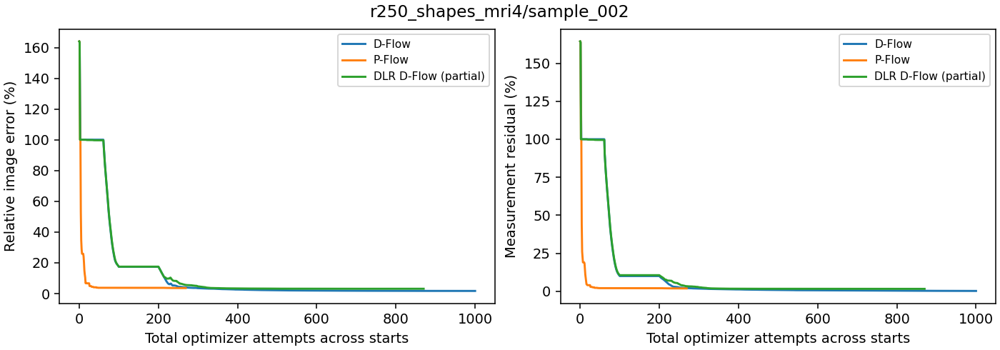
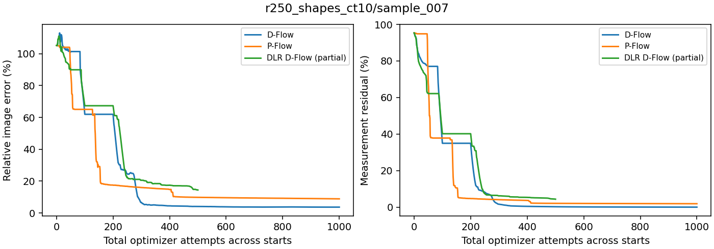

# Measurement-selected restart controls

Updated 2026-10-22T03:20-04:00.

Four cached starts per method: original Gaussian, half/full measurement-adjoint mixtures, and an independent Gaussian. Each receives up to 50 probe attempts; the lowest measurement loss selects a continuation with the remaining shared 1000-attempt budget. The selected optimizer state is preserved. Image error never selects a source.

These are selected failure cases, not a population estimate. Methods share the candidate pool but may choose different sources. Partial results are labeled.

| Case | Method | Selected source | Status | Total attempts | Image error | Measurement residual |
| --- | --- | --- | --- | ---: | ---: | ---: |
| r250_shapes_mri4/sample_002 | D-Flow | measurement_half | Complete | 1000 | 1.732% | 0.225% |
| r250_shapes_mri4/sample_002 | P-Flow | original | Complete | 269 | 3.597% | 1.862% |
| r250_shapes_mri4/sample_002 | DLR D-Flow | measurement_half | Partial | 870 | 3.153% | 1.593% |
| r250_shapes_ct10/sample_007 | D-Flow | measurement_half | Complete | 1000 | 3.665% | 0.034% |
| r250_shapes_ct10/sample_007 | P-Flow | independent | Complete | 1000 | 8.869% | 1.907% |
| r250_shapes_ct10/sample_007 | DLR D-Flow | measurement_half | Partial | 500 | 14.413% | 4.388% |

Checks: cached source hashes, measurement-loss selection, preserved continuation history, and total attempt budgets. Completed metrics are recomputed from saved image/measurement arrays. Curves show the best measurement-loss candidate seen during probing, then the selected continuation. They do not select by image error.

