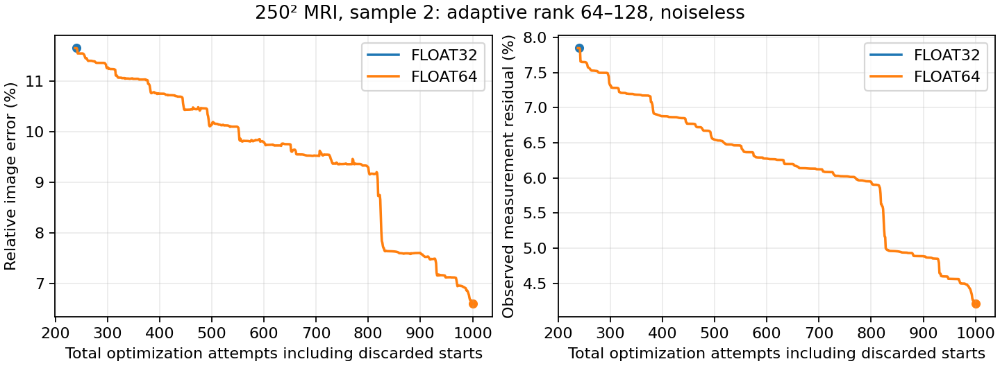

# Completed MRI adaptive-rank precision recovery

At the shared failed MRI endpoint, FP64 restores progress: relative image error decreases from 11.6586% to 6.5979%, and measurement residual from 7.8481% to 4.2054%. This is a selected-case result, not a general reconstruction correction or evidence about noise regularization.

| Precision | Final image error | Final residual | Total attempts | Outcome |
|---|---|---|---|---|
| FP32 | 11.6586% | 7.8481% | 240 | Two rejected searches |
| FP64 | 6.5979% | 4.2054% | 1000 | Original budget reached |

Both arms cold-started optimizer curvature at the same saved source, retained the same right basis and seeds, used the same adaptive rank64–128, relative cutoff0.001, analytical alpha, zero enrichment, five Euler steps and LBFGS/geometric Armijo. The data are noiseless250x250 MRI4x sample2 from the117k separated-shapes model. Native products were used initially; the FP64 continuation switched to independently validated graph replay after50 updates, preserving its history and optimizer state. The full original50-update history hashes still match.

The FP64 arm used850 selected-source attempts plus150 prior discarded-source attempts, totaling1000. FP32 ended at90+150=240 after rejected searches. Thus this result demonstrates recovered descent followed by further optimization; it is not a comparison with equal accepted update counts. At budget exhaustion, image error remains6.60%, so precision alone has not eliminated the reconstruction error.

Verification recomputes image error, complex residual and objective from original saved arrays, checks monotonic objectives, displacement limits, model/operator/source seeds, parent-checkpoint hash, unchanged settings, terminal statuses and total budgets. See [verification](verification.json). The high-start rank256 controls are separate experiments and remain pending.
