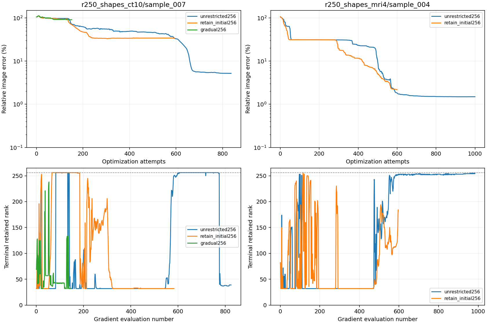

# High-start rank controls: latest saved evidence

Paired five-Euler-step, noiseless, FP32 controls with maximum rank 256, floor 32, analytical alpha, zero enrichment and unchanged LBFGS/geometric Armijo. Each sample runs its variants sequentially; pending variants are not results. The launch report documents the early graph-cache OOM and state-preserving resume.

| Case | Policy | Status | Attempts | Image error | Measurement residual | First terminal rank | Last recorded terminal rank |
|---|---|---|---:|---:|---:|---:|---:|
| r250_shapes_ct10/sample_007 | unrestricted256 | stalled | 836 | 5.194% | 0.929% | 32 | 39 |
| r250_shapes_ct10/sample_007 | retain_initial256 | stalled | 593 | 34.038% | 19.922% | 32 | 32 |
| r250_shapes_ct10/sample_007 | gradual256 | stalled | 152 | 90.780% | 72.360% | 69 | 32 |
| r250_shapes_mri4/sample_004 | unrestricted256 | step_limit | 1000 | 1.492% | 0.772% | 82 | 255 |
| r250_shapes_mri4/sample_004 | retain_initial256 | running | 600 | 2.184% | 1.471% | 82 | 184 |
| r250_shapes_mri4/sample_004 | gradual256 | Pending | — | — | — | — | — |

r250_shapes_ct10/sample_007: unrestricted initialization retained fewer than 256 directions in 0/824 recorded evaluations. Where it already retains 256, the initialization-only floor changes no retained rank. Differences from that control cannot automatically be attributed to a rank-policy improvement; floating-point execution variability and trajectory divergence remain possible.

r250_shapes_mri4/sample_004: unrestricted initialization retained fewer than 256 directions in 0/984 recorded evaluations. Where it already retains 256, the initialization-only floor changes no retained rank. Differences from that control cannot automatically be attributed to a rank-policy improvement; floating-point execution variability and trajectory divergence remain possible.

The earlier CT rank-128 result is a paired-problem historical reference, not a strict rank-cap-only control: derivative-kernel and graph execution settings also differ. [Verified scope and configuration differences](ct7_historical_comparison.json).

Completed paired reconstruction panels: [r250_shapes_ct10/sample_007, unrestricted256](r250_shapes_ct10/sample_007/unrestricted256/paired_methods.png) · [r250_shapes_ct10/sample_007, retain_initial256](r250_shapes_ct10/sample_007/retain_initial256/paired_methods.png) · [r250_shapes_ct10/sample_007, gradual256](r250_shapes_ct10/sample_007/gradual256/paired_methods.png) · [r250_shapes_mri4/sample_004, unrestricted256](r250_shapes_mri4/sample_004/unrestricted256/paired_methods.png)

Rank is measured on the approximated residual core with relative cutoff 0.001, not on a certified exact Jacobian. A small initial terminal rank does not imply that the same rank remains sufficient at later optimized sources. Retaining nearly the full cap indicates limited compression under this criterion, not proof that the true Jacobian requires that many directions.

Rank and image curves have different horizontal axes: gradient evaluations versus optimizer attempts. The last rank record may precede the latest accepted source; they should not be interpreted as a fixed-point pair. Duplicated evaluation numbers after checkpoint recovery use the most recent record. All curves are partial until their saved status is terminal.

The gradual policy limits shrinking inside each flow pass. Rank can rise across optimizer iterations because each new gradient initializes a new maximum-rank sketch. Accuracy comparisons between policies require completed paired runs or common completed prefixes; no such comparison is claimed while other policies are pending.

[Launch and recovery protocol](report.md) · [Independent saved-array verification](live_verification.json)
